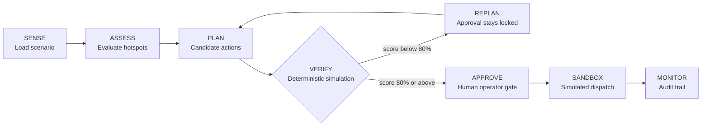
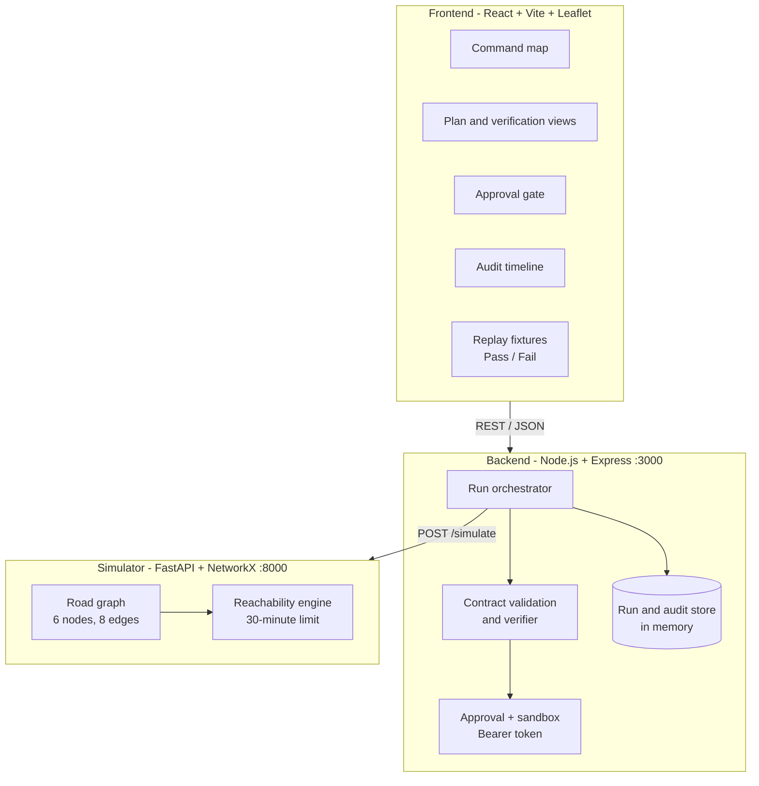

<div align="center">

# 🌧️ FloodShield Ops

### An AI-assisted pre-flood operations dashboard that **plans, verifies and gates** emergency actions before the water arrives.


**Team Nexora** · Mohammed Nisaruddin (Lead) · Uttham · Ibrahim Shaadan Akthar

*Sense the risk. Assess the impact. Verify before acting.*

</div>

---

## 📑 Table of Contents

- [The Problem](#-the-problem)
- [Our Solution](#-our-solution)
- [Decision Workflow](#-decision-workflow)
- [The Reachability Score](#-the-reachability-score)
- [Implementation Status](#-implementation-status-what-is-real)
- [System Architecture](#-system-architecture)
- [Project Structure](#-project-structure)
- [Getting Started (Command Prompt)](#-getting-started)
- [Environment Configuration](#-environment-configuration)
- [Testing](#-testing)
- [Demo Walkthrough](#-demo-walkthrough-2-minutes)
- [API Reference](#-api-reference)
- [Responsible AI and Safety](#-responsible-ai-and-safety-by-design)
- [Limitations and Roadmap](#-limitations-and-roadmap)
- [Team](#-team)
- [Acknowledgments](#-acknowledgments)

---

## 🚨 The Problem

Heavy-rain flooding hits fast-growing cities every monsoon. Forecasts, drainage status, traffic, hospital locations and relief resources live in different places, and control-room staff must combine them **by hand, under time pressure**. Decisions such as which road to close, where to stage ambulances and where to place pumps are made late, are rarely tested before they are applied, and are hard to audit afterwards.

The cost is blocked emergency routes. During a flood, minutes decide whether an ambulance reaches a hospital.

> **Our question:** *If this flood happens, what should the city do so that hospitals and shelters stay reachable, and can we prove the plan works before acting?*

**Pilot area:** Bengaluru, Mahadevapura corridor (Outer Ring Road, Marathahalli, Bellandur, Sarjapur Road), modelled on the early-September 2022 flood event.

## 💡 Our Solution

FloodShield Ops is a **command dashboard for city control rooms**. An operator loads a flood scenario, sees rainfall, hotspots, hospitals and shelters on a map, reviews proposed response actions, and checks them against an **independent, deterministic simulator** before anything can be approved.

> **The planner proposes. The simulator decides. A human approves. Nothing real is ever triggered.**

**Evidence over claims:** a recommendation is not a successful intervention until its claimed outcome has been verified. If a plan cannot demonstrate an improvement, the system reports that and requires replanning instead of inventing a successful result.

### Key features

| | Feature | What it does |
|---|---|---|
| 🗺️ | **Command map** | Leaflet map with flood hotspots, hospitals, shelters, the dispatch origin and response corridors. Falls back to a list view if map tiles are unavailable. |
| 📊 | **Reachability Score** | One measurable number, shown **before vs after** a plan, with per-facility detail. |
| ✅ | **Deterministic verification** | A separate Python simulator scores every plan, and the backend re-checks its result against the scenario. |
| 🔒 | **Human approval gate** | Approval stays locked while verification is pending or has failed. Approval and sandbox execution need an operator token. |
| 🔁 | **Replan loop** | A failing plan keeps approval locked and requires another iteration. |
| 🧾 | **Audit trail** | Every step (Sentinel, Risk, Planner, Verifier, Operator) is recorded and shown as a timeline. |
| 🌧️ | **Rainfall replay scrubber** | Step through the 6-hour rainfall profile and watch flood zones change. |
| 📰 | **Flood intelligence feed** | Five clearly labelled **sample** reports linked to hotspots. No live news integration. |
| 📤 | **Export dossier** | One-click incident report with scenario, hotspots, plan, results and audit entries. |
| ⌨️ | **Command palette** | `Ctrl + K` for navigation, hotspot and facility focus, run trigger and export. |

## 🔄 Decision Workflow



| Stage | What happens |
|---|---|
| **SENSE** | The scenario loads: area, bounding box, rainfall profile, facilities and hotspots. |
| **ASSESS** | Hotspots are ranked by risk, with reasons such as low elevation, heavy rainfall, underpasses, lake overflow and flooded road segments. |
| **PLAN** | Candidate actions are proposed: road closures, diversions, pump pre-positioning, ambulance staging. Each shows its rationale, evidence and confidence. |
| **VERIFY** | The simulator removes flooded roads from the graph, applies the plan and recomputes reachability from the fixed dispatch origin. The backend cross-checks the result against the scenario. |
| **REPLAN** | If the score is below the 80% threshold, approval stays locked and another plan iteration is required. The threshold is never lowered to make a plan pass. |
| **APPROVE** | An operator reviews the evidence, confirms the sandbox notice and adds an authorization note. |
| **SANDBOX** | The decision is recorded as a simulated event. No real alerts, closures or dispatch occur. |
| **MONITOR** | Every event is available in the audit timeline and the exported dossier. |

## 📏 The Reachability Score

A single, shared, reproducible definition used by the simulator, backend and UI:

```text
Reachability Score = facilities reachable from the dispatch origin within 30 minutes
                     ÷ total facilities
```

The same graph, facilities, origin and 30-minute limit are used for the baseline and for the plan, so the comparison is fair. A plan **passes at 80% or above**.

| Replay scenario | Baseline | With plan | Threshold | Result |
|---|---|---|---|---|
| **Plan 001** (pass) | 3 of 6 = **50.0%** | 5 of 6 = **83.3%** | 80% | ✅ Passed, approval unlocks |
| **Plan 002** (fail) | 2 of 6 = **33.3%** | 4 of 6 = **66.7%** | 80% | ❌ Failed, approval locked, replan required |

## 🧭 Implementation Status: What Is Real

We want to be upfront about exactly what this submission does today.

| Area | Status | Details |
|---|---|---|
| React operator dashboard | ✅ Implemented | Map, inspectors, plan and verification views, audit timeline, replay scrubber, dark and light themes, export, command palette. |
| Express orchestration API | ✅ Implemented | Scenario, run, approval, sandbox and audit endpoints with strict contract validation. Run state is held **in memory**. |
| Python deterministic simulator | ✅ Implemented | FastAPI service on a NetworkX road graph. Computes baseline and plan reachability and validates every request. |
| Verification and safety gates | ✅ Implemented | Backend re-checks simulator results. Empty plans are rejected. Tests guard against unsupported "improvement" claims. |
| Human approval and sandbox | ✅ Implemented | Bearer-token protected. Sandbox only writes to the audit log. |
| Replay scenario data | 🟡 Synthetic replay | Scenario `blr-2022-09-replay` uses curated hotspots, facilities and a small synthetic road graph (6 nodes, 8 edges). It is **not** verified Bengaluru infrastructure data. |
| Pass / Fail demo plans | 🟡 Replay fixtures | The dashboard's *Replay: Pass* and *Replay: Fail* modes use pre-authored plans to demonstrate verification and replanning end to end. |
| Flood intelligence feed | 🟡 Sample data | Five synthetic records, labelled as sample data. |
| LLM (Gemini) planner | 🔜 Planned | Not connected yet. In live mode the backend creates an empty candidate plan, which is correctly **rejected** with approval blocked. |
| Live weather, OpenStreetMap graph, database | 🔜 Planned | See the [roadmap](#-limitations-and-roadmap). |

> ⚠️ FloodShield Ops is **decision-support demo software**. It is not a flood prediction system and must not be used for real emergency-response decisions.

## 🏗️ System Architecture



| Layer | Folder | Responsibility |
|---|---|---|
| Dashboard | [`/frontend`](frontend) | Operator UI, replay fixtures, report export |
| Orchestrator | [`/backend`](backend) | Run lifecycle, schema validation, verification checks, approval and sandbox, audit log |
| Simulator | [`/simulator`](simulator) | Deterministic road-graph reachability for baseline and plan |
| Contracts | [`AGENTS.md`](AGENTS.md) | Shared JSON data contracts used by all three parts |
| Docs | [`/docs`](docs) | Operator, presentation and viva guide (Markdown and PDF) |

The backend, not the browser, holds the authoritative checks and the security-sensitive logic.

### Technology stack

| Part | Technologies |
|---|---|
| Frontend | React 18, Vite 5, Leaflet, lucide-react, JavaScript |
| Backend | Node.js, Express 4, CORS |
| Simulator | Python, FastAPI, Pydantic v2, NetworkX, Uvicorn |
| API security | Bearer-token authentication for protected actions |
| Testing | Node.js built-in test runner, pytest, Vite production build |

## 📁 Project Structure

```text
FloodShield-Ops/
├── README.md                          Project documentation (this file)
├── AGENTS.md                          Shared JSON data contracts and project rules
├── .gitignore                         Keeps .env files, node_modules and build output out of Git
│
├── frontend/                          React + Vite operator dashboard  (port 5173)
│   ├── index.html                     Entry page (fonts, Leaflet stylesheet)
│   ├── package.json                   Dependencies and scripts: dev, build, preview
│   ├── vite.config.js                 Vite configuration
│   ├── .env.example                   Frontend settings (API URL, poll interval, map key)
│   ├── README.md                      Frontend-specific notes
│   └── src/
│       ├── main.jsx                   App bootstrap
│       ├── App.jsx                    Layout, state, mode switching and screens
│       ├── api/
│       │   └── client.js              HTTP client for the backend and simulator
│       ├── hooks/
│       │   └── useOperationsRun.js    Run lifecycle: start, poll status, replay progression
│       ├── utils/
│       │   └── reportExporter.js      "Export Dossier" incident report
│       ├── styles/
│       │   └── theme.css              Design tokens, dark and light themes
│       ├── data/                      Replay fixtures and sample data
│       │   ├── replayFallback.json        Passing scenario (Plan 001)
│       │   ├── replayFailedPlan.json      Failing scenario (Plan 002), shows replanning
│       │   ├── replayAuditEvents.json     Sample audit trail
│       │   └── floodIntelligenceFeed.json 5 labelled sample reports
│       └── components/
│           ├── CinematicIntro.jsx             Start-up sequence
│           ├── CommandSpine.jsx               Left sidebar: navigation, telemetry, data mode
│           ├── ScenarioHeader.jsx             Scenario, rainfall and status header
│           ├── TopWorkflowStrip.jsx           SENSE to SANDBOX progress strip
│           ├── WorkflowTracker.jsx            Stage-by-stage workflow tracker
│           ├── RiskMap.jsx                    Leaflet map: hotspots, facilities, corridors, flood zones
│           ├── HotspotList.jsx                Ranked hotspots
│           ├── FacilityReachabilityList.jsx   Per-facility reachability before and after
│           ├── PlanActions.jsx                Proposed actions with rationale and evidence
│           ├── ScoreComparison.jsx            Baseline vs plan vs threshold
│           ├── Reachability3DGauge.jsx        Animated reachability gauge
│           ├── RainfallTimelineScrubber.jsx   Replay-hour control
│           ├── ApprovalPanel.jsx              Human approval gate and sandbox confirmation
│           ├── AuditTimeline.jsx              Chronological event trail
│           ├── ContextualInspector.jsx        Hotspot and facility inspector, evidence tabs, intel feed
│           ├── BottomCommandTray.jsx          Replay controls and verification status
│           ├── CommandPalette.jsx             Ctrl + K quick actions
│           └── ui/                            Shared primitives: Badge, Button, Modal
│
├── backend/                           Node.js + Express orchestrator  (port 3000)
│   ├── package.json                   Dependencies and scripts: start, test
│   ├── .env.example                   Backend settings (port, simulator URL, operator token)
│   ├── SECURITY.md                    Demo security notes
│   ├── src/
│   │   ├── server.js                  Starts the HTTP server
│   │   ├── app.js                     Routes, approval and sandbox logic, error handling
│   │   ├── contracts/
│   │   │   └── validation.js          Strict validation of Scenario, Plan, SimulationResult
│   │   ├── data/
│   │   │   └── replayScenario.js      Replay scenario: facilities and hotspots
│   │   ├── runs/
│   │   │   └── runStore.js            In-memory runs and audit entries
│   │   ├── simulator/
│   │   │   └── client.js              HTTP client for the Python simulator (with timeout)
│   │   └── verification/
│   │       └── verifier.js            Cross-checks simulator results against the scenario
│   └── test/                          Node test suites (38 tests)
│       ├── contract-validation.test.js
│       ├── scenario-api.test.js
│       ├── run-api.test.js
│       └── simulator-client.test.js
│
├── simulator/                         Python deterministic simulator  (port 8000)
│   ├── app.py                         FastAPI app: /health, /facilities, /hotspots, /simulate
│   ├── road_graph.py                  Synthetic road graph (NetworkX) and reachability engine
│   ├── test_app.py                    API tests
│   ├── test_road_graph.py             Graph and reachability tests (18 tests in total)
│   └── requirements.txt               Python dependencies
│
├── docs/
│   ├── FloodShield-Ops-Operator-Guide.md    Operator, presentation and viva guide
│   └── FloodShield-Ops-Operator-Guide.pdf   Same guide as a PDF
│
└── tools/
    └── generate-operator-guide-pdf.cjs      Script that builds the guide PDF
```

## 🚀 Getting Started

**Prerequisites:** Git, Node.js 20.6 or newer, Python 3.10 or newer, and a modern browser.

```bash
git clone https://github.com/nisar-studio/FloodShield-Ops.git
cd FloodShield-Ops
```

Open **three terminals** in the project folder, one per service. The commands below work in **Windows Command Prompt / PowerShell**, with macOS and Linux differences noted.

### 1️⃣ Simulator (port 8000)

```bat
cd simulator
python -m venv .venv
.venv\Scripts\activate
pip install -r requirements.txt
uvicorn app:app --port 8000
```

macOS / Linux: activate with `source .venv/bin/activate`.
Check it works: open `http://127.0.0.1:8000/health`.

### 2️⃣ Backend (port 3000)

```bat
cd backend
npm install
copy .env.example .env
```

Generate a random operator token, then paste it into `backend/.env` as the value of `OPERATOR_AUTH_TOKEN`:

```bat
node -e "console.log(require('crypto').randomBytes(32).toString('hex'))"
```

Start the backend:

```bat
node --env-file=.env src/server.js
```

macOS / Linux: use `cp .env.example .env` instead of `copy`.
Check it works: open `http://localhost:3000/api/health`.

> The backend reads settings from the process environment. The `--env-file` flag (Node 20.6+) loads `.env` for you, so a plain `npm start` will not pick the file up.

### 3️⃣ Frontend (port 5173)

```bat
cd frontend
npm install
copy .env.example .env
npm run dev
```

Open **http://localhost:5173**.

> 💡 **Offline-safe demo:** the dashboard's **Replay** modes run fully in the browser with no backend or simulator. Use them for a predictable demonstration. **Live API** mode needs the backend and simulator running.

## 🔐 Environment Configuration

**Backend** (`backend/.env`)

| Variable | Purpose |
|---|---|
| `PORT` | Backend HTTP port (default 3000) |
| `FRONTEND_ORIGIN` | Browser origin allowed to call the API |
| `SIMULATOR_BASE_URL` | Python simulator address (default `http://127.0.0.1:8000`) |
| `SIMULATOR_TIMEOUT_MS` | Maximum time for one simulator request |
| `OPERATOR_AUTH_TOKEN` | Secret required for approval and sandbox execution |
| `CONTROL_ROOM_OPERATOR` | Server-side operator name recorded in audit entries |

**Frontend** (`frontend/.env`)

| Variable | Purpose |
|---|---|
| `VITE_API_BASE_URL` | Backend address (default `http://localhost:3000`) |
| `VITE_DEFAULT_SCENARIO_ID` | Scenario loaded at start-up (`blr-2022-09-replay`) |
| `VITE_POLL_INTERVAL_MS` | How often run status is polled |
| `VITE_CARTO_API_KEY` | Optional map-tile key |

**Security practice:** never commit `.env` files or real tokens, never put the operator token in frontend code or `VITE_*` variables, and use a unique random token for demos.

## 🧪 Testing

Run these from the project root (Command Prompt or PowerShell):

```bat
cd backend
npm test
cd ..\simulator
python -m pytest -q
cd ..\frontend
npm run build
```

| Check | Expected result |
|---|---|
| `npm test` (backend) | 38 tests pass |
| `python -m pytest -q` (simulator) | 18 tests pass |
| `npm run build` (frontend) | Production build completes |

A passing build does not prove the whole application works end to end, so start all three services and walk through the demo before presenting.

## 🎬 Demo Walkthrough (2 minutes)

1. **Load the scenario.** In the sidebar, choose **Replay: Pass**. The scenario is Bengaluru, Mahadevapura corridor, with 125 mm of rain over 6 hours and 4 active hotspots.
2. **Explore risk.** Click a hotspot on the map to see its risk score, reasons and flooded road segments. Click a hospital or shelter to see its reachability.
3. **Run the loop.** Press **Simulate Run** and watch SENSE, ASSESS, PLAN and VERIFY progress.
4. **Read the proof.** Open **Verification**: baseline **50.0%** versus plan **83.3%** against the 80% threshold, with per-facility results.
5. **Approve.** The approval gate unlocks only because verification passed. Confirm the sandbox notice and add an authorization note.
6. **Show the safety side.** Switch to **Replay: Fail**: the plan scores 66.7%, approval stays **locked** and a replan is required.
7. **Finish.** Open **Audit** for the event trail and use **Export Dossier** for the incident report.

## 🔌 API Reference

**Backend** (`http://localhost:3000`)

| Method | Endpoint | Purpose |
|---|---|---|
| `GET` | `/api/health` | Service status and mode |
| `GET` | `/api/scenario/:scenarioId` | Scenario bundle: area, rainfall, facilities, hotspots |
| `POST` | `/api/run` | Start a run for `{ "scenarioId": "..." }` |
| `GET` | `/api/run/:runId` | Run status, steps, plan and simulation result |
| `POST` | `/api/plan/:planId/approve` | Operator approval 🔐 |
| `POST` | `/api/plan/:planId/execute-sandbox` | Record a sandbox execution 🔐 |
| `GET` | `/api/audit?runId=...` | Audit entries for a run |

🔐 Requires `Authorization: Bearer <OPERATOR_AUTH_TOKEN>`.

**Simulator** (`http://localhost:8000`): `GET /health`, `GET /facilities`, `GET /hotspots`, `POST /simulate`.

Shared JSON shapes (`Scenario`, `Facility`, `Hotspot`, `Action`, `Plan`, `SimulationResult`, `AuditEntry`) are defined in [`AGENTS.md`](AGENTS.md).

## 🛡️ Responsible AI and Safety by Design

- **Sandbox only:** no SMS, email, radio, road control, vehicle dispatch or pump control. "Execution" is an audit-log record.
- **Human in the loop:** approval is required and is locked unless verification passed.
- **No self-grading:** the planning side never decides whether its own plan passes. A separate deterministic simulator does, and the backend cross-checks the result.
- **Honest data labelling:** replay, synthetic and sample data is labelled as such throughout the UI and docs.
- **Hardened inputs:** strict schema validation, request size limits, constant-time token comparison, and the operator identity is set server-side. See [`backend/SECURITY.md`](backend/SECURITY.md).
- **No secrets in the repo:** `.env` files are git-ignored. Only `.env.example` files are committed.
- **Privacy:** no personal data is collected or stored.

## ⚠️ Limitations and Roadmap

**Current limitations**
- Scenario data and the road graph are synthetic and small, built for a reproducible demonstration. They are not verified Bengaluru infrastructure, travel times or live flood measurements.
- The LLM planner is not connected, so plan proposals in the demo come from replay fixtures.
- Runs and audit entries are stored in memory and are lost on restart.
- Authentication is a single shared demo token, not a user-management system.
- The map is 2D Leaflet, not a 3D terrain engine.
- Not validated for real emergency use. That would need validated data, domain-expert review, reliability testing and proper authorization.

**Roadmap**
1. Connect a Gemini planner using structured output and function calling. Its proposals would flow through the same validation and verification path.
2. Replace the synthetic graph with a real OpenStreetMap road network, hospitals and shelters for the pilot area.
3. Ingest live forecast and historical rainfall data, plus elevation for hotspot scoring.
4. Persist runs, plans and audit logs in a database.
5. Add per-user authentication and roles.
6. Add scenario comparison, sensitivity analysis and end-to-end integration tests.
7. Support more cities and other hazards (heat waves, outages) through the same plan, verify and approve loop.

## 👥 Team

**Team Nexora**, ChronoForge, NITK Surathkal, Agentic AI track.

| Member | Focus |
|---|---|
| **Mohammed Nisaruddin** (Team Lead) | Express orchestration API, contract validation, verification, approval and audit |
| **Uttham** | Python simulator, road graph and reachability engine, simulator API and tests |
| **Ibrahim Shaadan Akthar** | React operator dashboard, replay fixtures, report export, operator guide |

**Repository:** [nisar-studio/FloodShield-Ops](https://github.com/nisar-studio/FloodShield-Ops)

## 🙏 Acknowledgments

- **Frameworks and libraries:** [React](https://react.dev), [Vite](https://vitejs.dev), [Leaflet](https://leafletjs.com), [lucide-react](https://lucide.dev), [Express](https://expressjs.com), [cors](https://github.com/expressjs/cors), [FastAPI](https://fastapi.tiangolo.com), [Pydantic](https://docs.pydantic.dev), [NetworkX](https://networkx.org), [Uvicorn](https://www.uvicorn.org).
- **Map tiles:** © [OpenStreetMap](https://www.openstreetmap.org/copyright) contributors and © [CARTO](https://carto.com/attributions).
- **Fonts:** Inter, JetBrains Mono and Space Grotesk via Google Fonts.
- **Scenario reference:** the September 2022 Bengaluru flood event as described in public news reports of KSNDMC rainfall readings. Values in this repo are replay and synthetic demonstration data, not official records.
- **AI-assisted coding tools** were used during development. The team is responsible for all submitted code.

---

<div align="center">

Built from scratch for **ChronoForge** at **NITK Surathkal** by **Team Nexora** 🌧️

*The planner proposes. The simulator decides. A human approves.*

</div>
